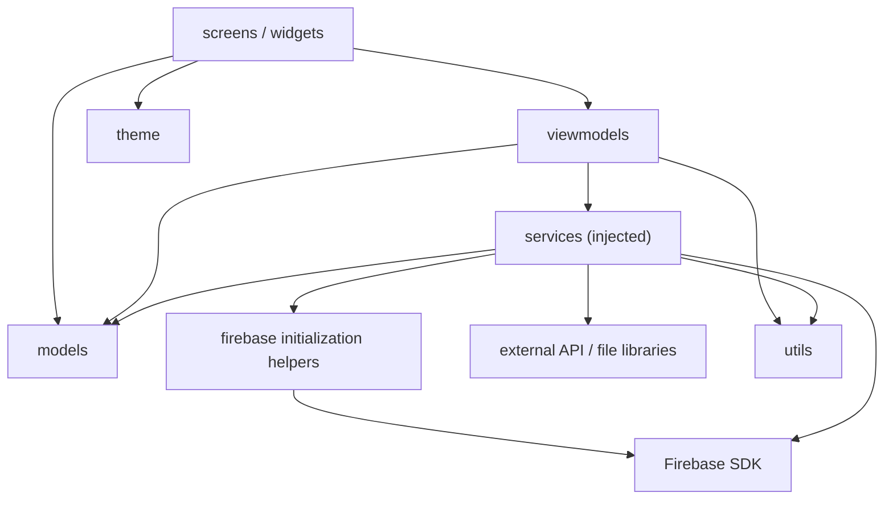
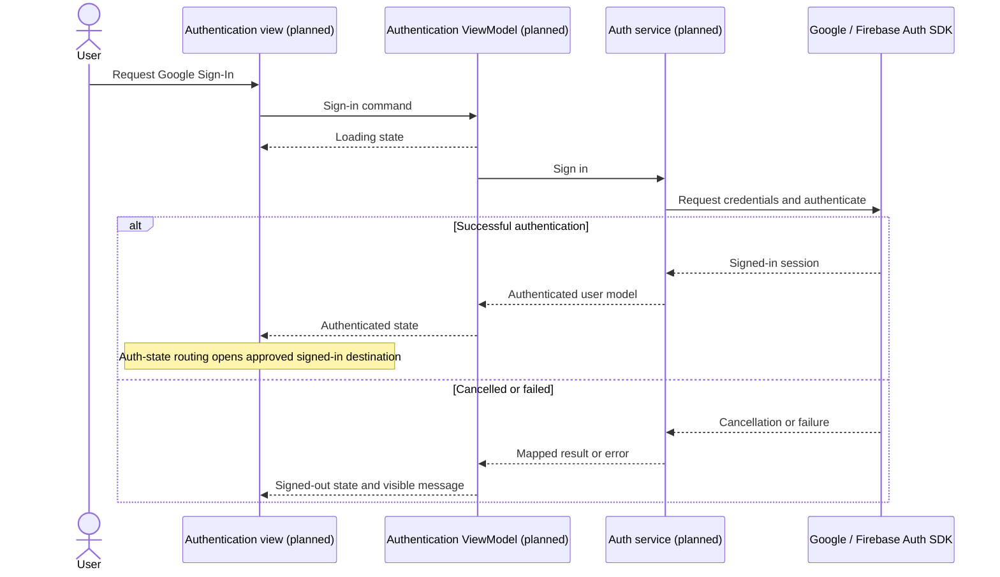

# Architecture

Status: Flows 1, 2 and 3 implemented with Flutter 3.47.4, Dart 3.13.3 and Provider 6.1.5+1.
Firebase client configuration exists. AI Logic CLI setup has enabled the Gemini
Developer API provider for Android/web and confirmed App Check as `ENFORCED`
without changing billing. App Check token exchange and a non-personal
`gemini-3.6-flash` healthcheck returned HTTP 200; the temporary token was revoked.
End-user App Check setup and real-meal/native-device behavior remain unverified.
Owner rules for profiles, meals and lesson progress are deployed and match
local sources. The sections below retain the wider Lab 3 plan.

## Implemented flow 3

- `LearningViewModel` owns progress/catalogue/reader selection, read-state loading,
  explicit saves, retry and cancellation. It is composed in the same UID-keyed
  Provider tree as profiles/meals; sign-out/account changes dispose private state.
- `AssetLessonCatalog` joins the source outline and 30 authored introductory
  bodies. Stable identities and separate source-page metadata are validated;
  only 27 core units contribute to the core completion counter.
- `LearningFlowScreen` follows four Figma references and reuses existing cards,
  app bars, buttons, fonts and navigation. Weekly counts derive from actual saved
  meal records by local calendar week, without inferring vegetable compliance.
- `LocalLessonProgressRepository` serializes preview writes/clear. Cloud progress
  uses `users/{uid}/lessonProgress/{lessonId}`, validated by owner/profile/schema
  rules. Repeated completion uses one document, never another counter event.
- Preview sign-out locks pointer, focus, semantics and back navigation across all
  three repositories, preventing new progress while other storage is clearing.
- Book excerpts are short original paraphrases of inspected pages, not embedded
  scans or complete chapter reproductions. This flow uses bundled content, not AI.

See [Flow 3 contract](flow3-contract.md), [book grounding](flow3-book-grounding.md)
and [setup](flow3-setup.md).

## Implemented flow 2

- `MealViewModel` owns entry, recognition, ingredient confirmation, analysis,
  result, errors and dated journal states. Each authenticated UID gets its own
  instance. Navigation stays inside that session, and async generation guards
  discard responses after editing, sign-out or disposal.
- `DeviceMealPhotoPicker` handles camera/gallery, size/type checks, and
  owner-bound Android lost-photo recovery. Photos are transient.
- `BookMealIntelligence` provides explicitly labelled local matching over 15
  source-verified paraphrases. `AiLogicMealIntelligence` uses `firebase_ai` with
  Firebase AI Logic's Gemini Developer API backend in the cloud path.
- AI Logic initialization follows Firebase initialization and App Check setup.
  The Spark provider is activated for this project; device/web App Check setup
  and an available free-tier model are still needed. It does not require Cloud
  Functions, Secret Manager or a Gemini key in Flutter.
- The AI adapter derives minimal metadata from the signed-in session's loaded
  profile, retrieves verified source entries and validates structured model
  output/source IDs locally. Prompts/validators are client code, not a trusted
  server boundary. App Check and provider/AI Logic quotas protect API access.
- `functions/` retains the earlier Node 22 backend as an optional legacy Blaze
  implementation. Its authoritative profile lookup and 40/day, 6/minute quota
  are not used by the default Spark path.
- `LocalMealRepository` serializes preview journal writes. Cloud records live at
  `users/{uid}/meals/{id}` behind owner rules. Stable IDs make save retries update
  one record. Preview sign-out clears local meals; cloud sign-out retains history.

See [data contract](flow2-contract.md), [source grounding](meal-book-grounding.md)
and [setup](flow2-setup.md) for the implemented boundary.

## Implemented flow 1

- `lib/app.dart` composes Provider dependencies, preview/cloud startup and auth routing.
- `lib/screens/flow_screen.dart` renders four Figma-derived screens and delegates actions.
- `lib/viewmodels/onboarding_view_model.dart` owns loading/welcome/profile/goals/home/error,
  draft validation, derived age, saving, retry and lifecycle guards.
- `lib/viewmodels/auth_view_model.dart` owns Google sign-in cancellation/failure and session state.
- `lib/services/onboarding_repository.dart` is the injected profile contract.
- `LocalOnboardingRepository` persists only explicit preview data via SharedPreferencesAsync.
- `FirestoreOnboardingRepository` is bound to a UID and reads/writes `users/{uid}`.
- `FirebaseAuthService` encapsulates native Google Sign-In and Firebase web popup.
- `lib/firebase/` and `lib/firebase_options.dart` contain bootstrap and generated
  client configuration for the registered VetaLife app.
- `lib/theme/` and `lib/widgets/` centralize verified Figma tokens and components.

| ViewModel | Injected service | Observable state |
| --- | --- | --- |
| OnboardingViewModel | OnboardingRepository | stage, draft/errors, selectedGoal, isSaving, profile |
| AuthViewModel | AuthService | loading, busy, uid, errorMessage |

```mermaid
sequenceDiagram
    actor User
    participant Screen as Profile / Goal screen
    participant VM as OnboardingViewModel
    participant Repo as OnboardingRepository
    participant Store as Preview storage or owner Firestore document
    User->>Screen: Enter profile and select goal
    Screen->>VM: continueToGoals / selectGoal / save
    VM->>VM: Validate date and positive measurements
    VM-->>Screen: Saving; prevent duplicate submission
    VM->>Repo: save(profile with selected goal)
    Repo->>Store: Persist complete profile
    alt Save succeeds
        Store-->>Repo: Success
        Repo-->>VM: Complete
        VM-->>Screen: Home with saved profile
    else Save fails
        Store-->>Repo: Error
        Repo-->>VM: Failure
        VM-->>Screen: Keep draft and goal; offer retry
    end
```

Cloud mode disposes the UID-keyed profile Provider on sign-out/account change.
Firestore disk persistence is disabled; pending callbacks cannot repopulate a
disposed/reset ViewModel. Cloud sign-out preserves the server profile. Explicit
preview sign-out clears only its own preferences key, then resets the draft.
No profile values are sent to Analytics. See [Firebase setup](firebase-setup.md).

## Source requirements and current scope

- `PRM393 - Lab 3 Cloud-Enabled Mobile App (Firebase, Patrol, AI Code Review).pdf`, section 5, pages 4-6: MVVM, downward dependencies, injected services, explicit screen states, centralized design tokens, and reusable widgets. Its suggested folders include `models/`, `services/`, `firebase/`, `viewmodels/`, `screens/`, `widgets/`, and `utils/`.
- `PRM393 - Lab 3 From Design to Working App with Flutter and Firebase.pdf`, section 5, pages 3-4: the same MVVM boundaries, with `theme/` for Lab 2 tokens and one ViewModel per screen.
- `PRM393_Lab3_Preparation_Guide_v5_ToiUu.pdf`, page 4: View -> ViewModel -> Service -> Firebase SDK, clear loading/data/empty/error states, and fake services for tests.

The PDFs are local references under `docs/requirements/` and must not be committed. Both Lab 3 specifications place the Flutter application at repository root. The final assignment's `mobile/`, `web/`, and `packages/core/` layout belongs to a later phase; it is not introduced in this Lab 3 scaffold.

The earlier scaffold has been implemented as the Flutter application described
above, using Provider consistently. Remaining lab-service plans below should
not be read as verification of features outside the three implemented flows.

ARTEMIS is the confirmed Android E2E tool, and Firebase Cloud Storage is the selected file-storage service under the primary Lab 3 baseline. Device/model setup for ARTEMIS and the actual Firebase project's Storage availability, configuration, and owner-scoped rules still need verification during implementation.

## Folder responsibilities

| Path | Responsibility |
| --- | --- |
| `lib/models/` | Plain Dart data structures and serialization; no UI imports or service calls. |
| `lib/services/` | All Firebase/external API access, file export, and external operations. |
| `lib/firebase/` | Firebase initialization and SDK configuration helpers for services; screens never import this folder. |
| `lib/viewmodels/` | Screen state and business logic; services are injected so tests can use fakes. |
| `lib/screens/` | Render ViewModel state and forward user actions; no SDK calls or business logic. |
| `lib/widgets/` | Reusable Lab 2 components, variants, and loading/empty/error presentation. |
| `lib/theme/` | Lab 2 tokens expressed as theme, colors, typography, spacing, radius, and elevation. |
| `lib/utils/` | Small shared helpers independent of screens and ViewModels. |
| `android/` | Android platform project, to be generated when the Flutter project is initialized. |
| `assets/images/`, `assets/icons/`, `assets/fonts/` | Runtime assets from the approved design; declare actual assets in the future manifest. |
| `firebase/` | Versioned security rules and configuration templates; distinct from Dart helpers in `lib/firebase/`. |
| `test/unit/` | Future model, ViewModel, utility, and service tests with fakes. |
| `test/widget/` | Future component and screen rendering/interaction tests. |
| `e2e_test/` | ARTEMIS pytest scenarios and shared setup for Android E2E verification. |
| `docs/` | Design traceability, plans, decisions, and implementation records. |
| `evidence/` | Captured app, Firebase, E2E, and review evidence; never fabricated results. |
| `report/`, `slides/` | Final Lab 3 deliverable PDFs, to be created after implementation and verification. |

The original `data/`, `domain/`, and `presentation/` directories contained only `.gitkeep` files. They are replaced with the flat MVVM structure shared by the Lab 3 handouts to avoid duplicate model and ViewModel locations. No application code is migrated.

## Planned layer dependencies

Arrows below mean “may depend on.” Dependencies do not point upwards. Models and utilities remain independent of the UI. Widgets read theme tokens instead of duplicating hard-coded styling. Firebase and other external SDK calls occur in services or their Firebase helpers only.



Each data-loading ViewModel will expose explicit loading, data, empty, and error states. Screens render those states and send commands back to the ViewModel. Cancellation, no network, and permission failures will become user-visible state instead of uncaught errors.

## Planned authentication sequence

This is a design example for the required Google Sign-In flow, not an implemented or verified interaction. The actual route names and UI will come from the Lab 2 handoff.



Sign-out will clear user-specific local state and return to the signed-out route. Details such as auth-state subscriptions and cancellation handling will be finalized with the selected state manager.

## Planned ViewModel-to-service mapping

These are responsibility placeholders, not existing classes. Feature-specific names, routes, and data sources await the Lab 2 files.

| Planned responsibility | Planned service dependency | State / verification to define |
| --- | --- | --- |
| Authentication and profile | Authentication service | Signed-in/out, loading, cancellation, failure, and user-state cleanup. |
| Each Lab 2 data-loading screen (TBD) | Topic-specific data service (API or Firestore, TBD) | Loading, data, empty, error, and retry matching the approved handoff. |
| File export and upload demonstration | Report export service and Firebase Cloud Storage service | Generation/upload progress, completion URL, and failure; verify actual project setup and owner-scoped rules during implementation. |
| Notifications demonstration | Messaging service | Permission, received notifications, and navigation request. |
| Remote Config demonstration | Remote configuration service | Defaults, fetched values, and visible behavior changes. |
| Instrumentation used by relevant ViewModels/services | Analytics and crash reporting services | Event contracts and handled-error reporting; test-crash control only in the demonstration area. |

Before feature development, replace the TBD entries using the actual Lab 2 handoff, complete the design traceability and analytics plans, choose the state manager, and verify the ARTEMIS environment and Firebase Cloud Storage setup and owner-scoped rules.
